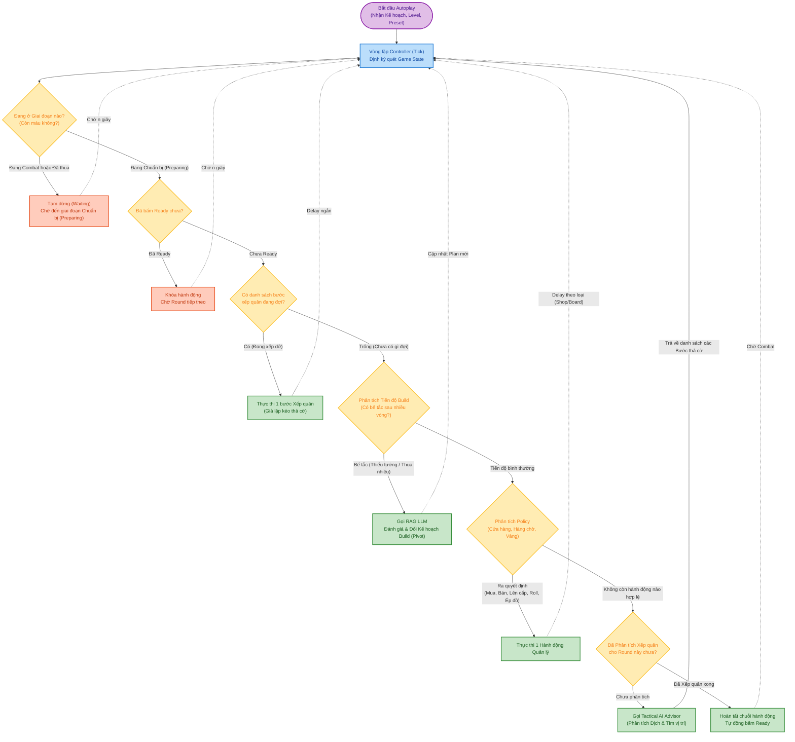
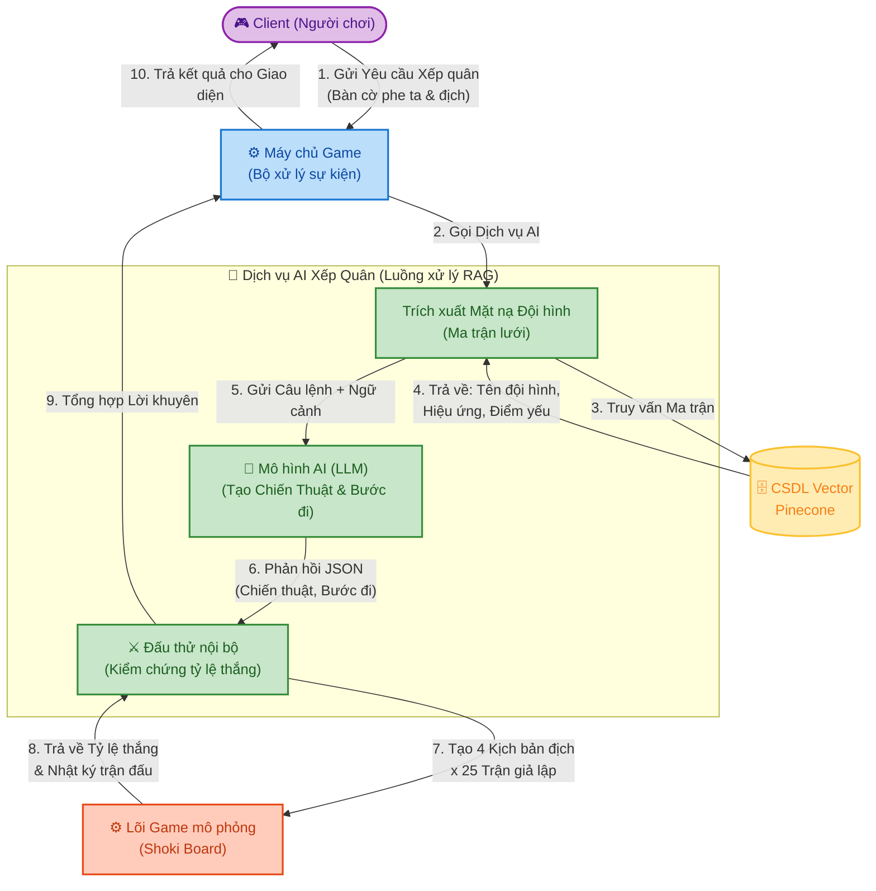
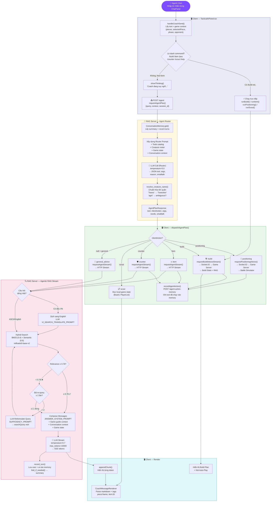
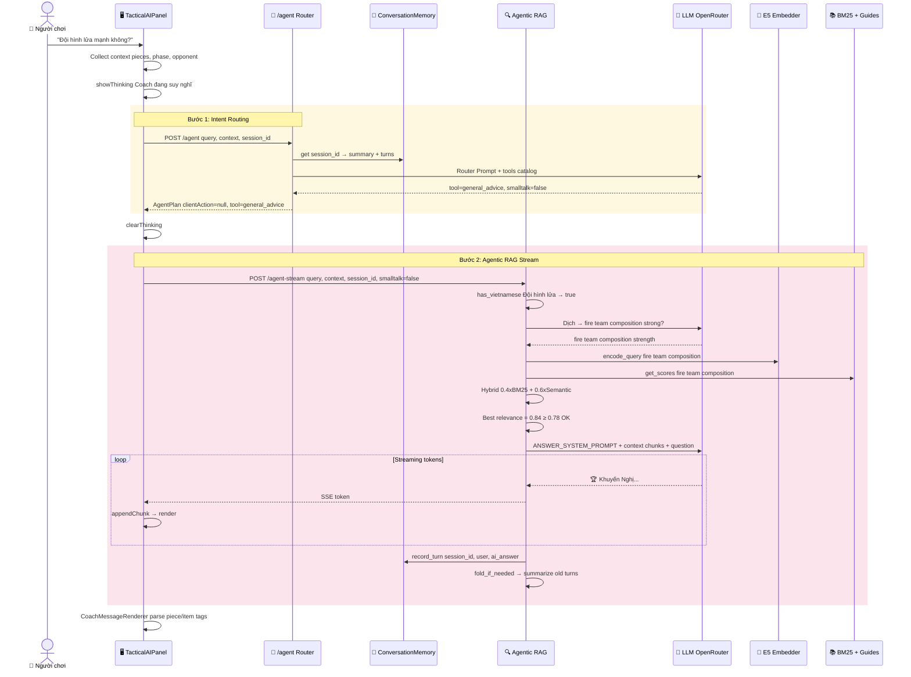
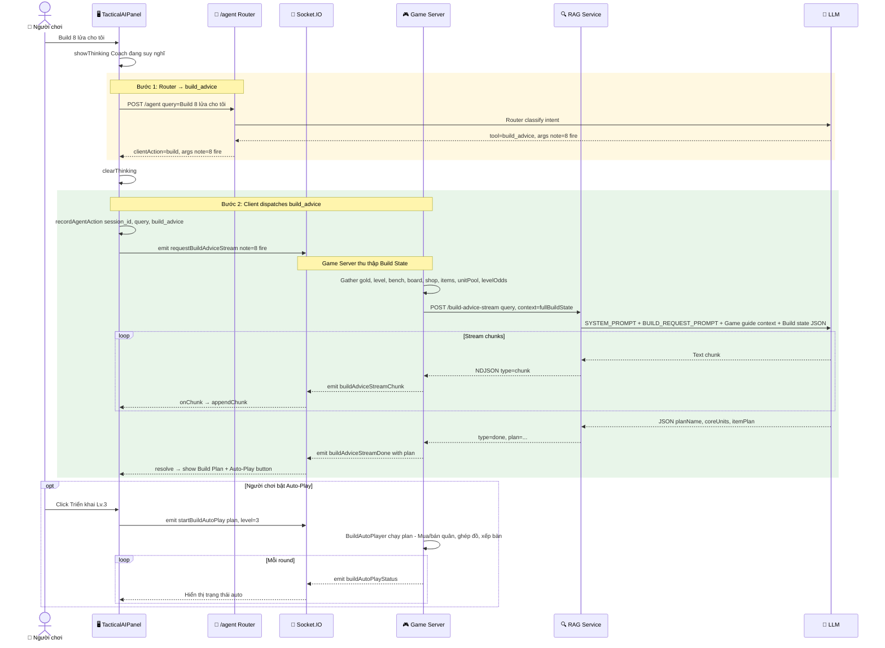
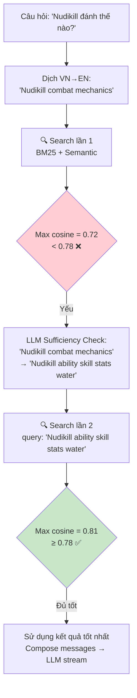
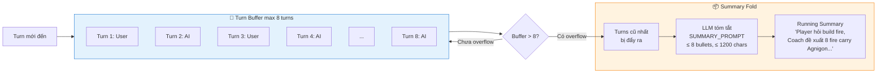

# Thuật Toán PPO & Flow Chat RAG — Creature Chess

---

## Phần 1: Sơ Đồ Khối Thuật Toán PPO (Proximal Policy Optimization)

### 1.1 Tổng Quan PPO

PPO là thuật toán Reinforcement Learning thuộc họ Policy Gradient, được dùng trong Creature Chess để huấn luyện bot **tự động chọn đội hình (formation) và điều chỉnh vị trí (adjustment)** tối ưu cho mỗi trận đấu.

### 1.2 Flowchart Thuật Toán PPO

```mermaid
flowchart TD
    START(["🟢 START: Khởi tạo PPO Agent"])

    INIT["Khởi tạo Policy Weights π_θ<br/>Khởi tạo Value Weights V_θ<br/>Config: lr=0.0003, γ=0.99, λ=0.95, ε=0.2"]

    subgraph COLLECT["📦 Thu Thập Trajectory"]
        OBS["Quan sát State s_t<br/>(Board, UnitClasses, Synergies)"]
        ENCODE["StateEncoder.encode()<br/>Chuyển board → Float32Array"]
        POLICY["Policy Network π_θ(s_t)<br/>Tính logits cho từng formation<br/>& adjustment"]
        SOFTMAX["Softmax với Temperature<br/>P(a) = exp(logit/T) / Σexp(logit/T)"]
        SAMPLE["Lấy mẫu Action<br/>formation: tank_front, spread_backline...<br/>adjustment: protect_carry, flank_assassin..."]
        EXEC["Thực thi Action trong Game<br/>ActionDecoder.decodeAction()"]
        REWARD["Nhận Reward r_t<br/>(Win/Loss/Draw + Survival margin)"]
        STORE["Lưu Experience<br/>{s_t, a_t, r_t, log π_θ(a_t|s_t)}"]
    end

    BATCH{"Đủ batch_size?<br/>(≥ 32 experiences)"}

    subgraph UPDATE["🔄 PPO Update"]
        RETURNS["Tính Returns G_t<br/>G_t = r_t + γ·r_(t+1) + γ²·r_(t+2) + ..."]
        GAE["Tính Advantages A_t (GAE-λ)<br/>δ_t = r_t + γ·V(s_(t+1)) − V(s_t)<br/>A_t = Σ (γλ)^l · δ_(t+l)"]

        subgraph CLIP_OBJ["🎯 PPO Clipped Objective"]
            RATIO["Tính Ratio: r_θ = π_new(a/s) / π_old(a/s)<br/>= exp(log_prob_new − log_prob_old)"]
            CLIP["Clip Ratio:<br/>r_clip = clamp(r_θ, 1−ε, 1+ε)<br/>ε = 0.2"]
            LOSS["Policy Loss:<br/>L = −min(r_θ·A_t, r_clip·A_t)"]
        end

        GRAD["Gradient Descent<br/>w ← w − lr × ∂L/∂w<br/>lr = 0.0003"]
        CLEAR["Xóa Experience Buffer"]
    end

    SAVE{"Đủ 50 experiences<br/>kể từ lần save?"}
    SAVE_MODEL["💾 Lưu Model<br/>saveModel(policyWeights, valueWeights)"]

    CONTINUE{"Game kết thúc?"}
    DONE(["🔴 END"])

    START --> INIT
    INIT --> OBS
    OBS --> ENCODE
    ENCODE --> POLICY
    POLICY --> SOFTMAX
    SOFTMAX --> SAMPLE
    SAMPLE --> EXEC
    EXEC --> REWARD
    REWARD --> STORE
    STORE --> BATCH

    BATCH -- "Chưa đủ" --> OBS
    BATCH -- "Đủ ≥ 32" --> RETURNS

    RETURNS --> GAE
    GAE --> RATIO
    RATIO --> CLIP
    CLIP --> LOSS
    LOSS --> GRAD
    GRAD --> CLEAR

    CLEAR --> SAVE
    SAVE -- "Chưa đủ" --> CONTINUE
    SAVE -- "Đủ 50" --> SAVE_MODEL
    SAVE_MODEL --> CONTINUE

    CONTINUE -- "Chưa" --> OBS
    CONTINUE -- "Rồi" --> DONE

    style START fill:#00c853,color:#fff
    style DONE fill:#ff1744,color:#fff
    style CLIP_OBJ fill:#fff3e0,stroke:#ff9800
    style COLLECT fill:#e3f2fd,stroke:#2196f3
    style UPDATE fill:#fce4ec,stroke:#e91e63
```

### 1.3 Giải Thích Chi Tiết Từng Bước

| Bước | Component | Mô tả |
|------|-----------|-------|
| **State Encoding** | `StateEncoder.encode()` | Chuyển trạng thái bàn cờ (vị trí quân, đối thủ) thành `Float32Array` |
| **Policy Forward** | `PPOAgent.act()` | Tính xác suất cho 7 formations × 5 adjustments qua softmax |
| **Action Sampling** | `sampleAction()` | Lấy mẫu ngẫu nhiên theo phân phối xác suất (exploration) |
| **Execution** | `ActionDecoder.decodeAction()` | Giải mã action thành danh sách moves `{pieceId, targetX, targetY}` |
| **Returns** | `calculateReturns()` | Tính discounted cumulative return: `G_t = Σ γ^k · r_(t+k)` |
| **GAE** | `calculateAdvantages()` | Generalized Advantage Estimation giảm variance |
| **Clipped Loss** | `update()` | Core PPO: clip ratio để tránh policy thay đổi quá lớn |
| **Weight Update** | `updatePolicyWeights()` | Gradient descent đơn giản: `w -= lr × loss` |

### 1.4 Các Hyperparameters Trong Project

| Parameter | Giá trị | Ý nghĩa |
|-----------|---------|---------|
| `learningRate` | 0.0003 | Tốc độ học |
| `gamma (γ)` | 0.99 | Discount factor — trọng số phần thưởng tương lai |
| `lambda (λ)` | 0.95 | GAE lambda — cân bằng bias vs variance |
| `epsilon (ε)` | 0.2 | Clip range cho PPO objective |
| `batchSize` | 32 | Số experience tối thiểu trước khi update |
| `temperature` | 1.0 | Softmax temperature — điều chỉnh exploration |
| `entropyCoef` | 0.01 | Hệ số entropy bonus — khuyến khích khám phá |

---

## Phần 2: Flow Thực Tế Của Hệ Thống Chat RAG (Agentic RAG)

### 2.1 Tổng Quan Kiến Trúc

Hệ thống chat sử dụng kiến trúc **Agentic RAG** (Retrieval-Augmented Generation có Agent routing), gồm:
- **Client** (React web-game): UI chat panel, thu thập game context
- **RAG Server** (FastAPI Python): Agent routing, retrieval, LLM streaming
- **Game Server** (Node.js Socket.IO): Cung cấp game state cho build/positioning

### 2.2 Flowchart Tổng Thể — Từ Tin Nhắn Đến Trả Lời

### 2.3 Flow Chi Tiết — Ví Dụ Cụ Thể

#### Ví dụ 1: Câu hỏi tự nhiên — "Đội hình lửa mạnh không?"

#### Ví dụ 2: Yêu cầu hành động — "Build 8 lửa cho tôi"

#### Ví dụ 3: Re-query khi Retrieval yếu

### 2.4 Conversation Memory Flow

### 2.5 Bảng Tóm Tắt Các Endpoint

| Endpoint | Method | Mô tả | Caller |
|----------|--------|-------|--------|
| `/agent` | POST | Intent routing — quyết định tool | Client HTTP |
| `/agent-stream` | POST | Agentic RAG streaming answer | Client HTTP SSE |
| `/agent-action-memory` | POST | Ghi nhớ tool đã chạy | Client fire-and-forget |
| `/query` | POST | RAG query đơn giản non-stream | Game Server Socket |
| `/query-stream` | POST | RAG streaming legacy | Client HTTP SSE |
| `/build-advice-stream` | POST | Build advice + JSON plan NDJSON | Game Server Socket |
| `/counter-advice` | POST | Counter analysis | Game Server Socket |
| `/item-advice` | POST | Item recommendation | Game Server Socket |
| `/health` | GET | Health check | Docker/monitoring |

### 2.6 Bảng Tools Trong Agent Router

| Tool | Client Action | Chạy ở đâu | Cần gì |
|------|---------------|-------------|--------|
| `positioning_advice` | `positioning` | Game Server (battle sim) | myBoard, bothOpponents, preparing phase |
| `build_advice` | `build` | Game Server → RAG | Build state (gold, shop, units...) |
| `item_advice` | `item` | RAG direct (agent-stream) | Target piece name |
| `counter_advice` | `counter` | RAG direct (agent-stream) | Enemy board/archetype |
| `scout` | `scout` | Client local state | Opponent data from Redux |
| `general_advice` | `null` | RAG direct (agent-stream) | Không cần thêm |

> **Lưu ý quan trọng:**
> **Action tools** (positioning, build) chạy trên **Game Server** vì cần live game state (gold, shop, unit pool) mà client không có đủ. **Knowledge tools** (item, counter, general) gọi thẳng RAG server qua HTTP streaming.
